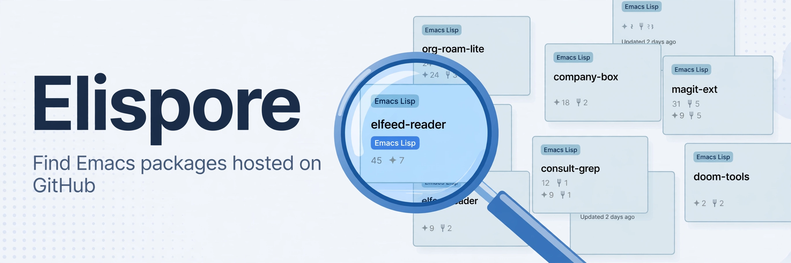

<p align="center">
  
</p>

<p align="center"><strong>Find Emacs packages hosted on GitHub</strong></p>

<p align="center">
  <a href="https://github.com/conao3/ts-elispore/actions/workflows/ci.yml"></a>
  <a href="LICENSE"></a>
  <a href="flake.nix"></a>
  <a href="https://github.com/conao3/ts-elispore/stargazers"></a>
</p>

<p align="center">
  <a href="https://elispore.conao3.com">Site</a> ·
  <a href="#search">Search</a> ·
  <a href="#installation-examples">Installation examples</a> ·
  <a href="#development">Development</a> ·
  <a href="#catalog">Catalog</a> ·
  <a href="#deployment">Deployment</a> ·
  <a href="#license">License</a>
</p>

# Elispore

[elispore.conao3.com](https://elispore.conao3.com) finds Emacs packages and libraries hosted on GitHub.

## Search

Search a GitHub metadata catalog with `user:minad`, `topic:completion`, `license:gpl-3.0`, `pushed:>=2026-01-01`, `stars:>=1000`, and `language:"Emacs Lisp"`. Sidebar selections appear directly in the query.

Click an owner to add a user filter, or a topic in an expanded row to add a topic filter. Select an `owner/repo` label to copy it without spaces. Rows expand in place and keep their geometry, and multiple rows can stay open for comparison.

Categories show the ten most frequent informative catalog topics, plus any selected topic outside that list. Topic matching ignores case, drops a leading `emacs-` and a trailing plural `s`, folds theme variants such as `dark-theme` into `theme`, and maps `mode` and `major-mode` to `major-mode`. Category counts deduplicate aliases within each repository.

## Installation examples

Installation examples default to leaf. Buttons at the top right of each code block switch between leaf and use-package, and Copy copies the displayed snippet. Both use `:vc` with the upstream GitHub URL. Leaf requires `:vc` support and Emacs 29+, and use-package `:vc` is included in Emacs 30+.

## Development

```sh
nix develop --command pnpm install --frozen-lockfile
nix develop --command pnpm exec vp run check
nix develop --command pnpm run build
nix build
nix run
```

`nix run` serves the built site at `http://127.0.0.1:4173`.

Browser validation uses `nix develop .#browser --command node test/browser.mjs` on Linux. It creates an isolated Chromium profile and checks the built `dist/` files. Screenshots go to the ignored `.claude-dev/scratch/`.

### UI

Interactive UI uses Adobe's `react-aria-components`: SearchField, RadioGroup, Checkbox, Select/ListBox/Popover, Disclosure, ToggleButtonGroup, Button, Link and DialogTrigger/Modal/Dialog. Components own keyboard navigation, ARIA state and focus handling. Tailwind CSS v4 is integrated through `@tailwindcss/vite`; custom CSS defines the warm palette with a coral accent and system light/dark themes. References: [React Aria](https://react-aria.adobe.com/), [Disclosure](https://react-aria.adobe.com/Disclosure), [Select](https://react-aria.adobe.com/Select).

The layout keeps search and results first:

- Search comes first.
- A sticky header shows catalog size, refresh date and the source link.
- Left filters sit beside one grouped result card with row dividers.
- Expanded rows add metadata, topic buttons and syntax-colored installation code without repeating the row title or description.
- Requirements appear on request.
- On mobile, Filters opens a modal sheet with a close control and a Show packages button.

Keep copy sparse; avoid promotional heroes, eyebrow labels and routine active-state badges.

## Catalog

`nix develop --command pnpm run catalog` uses authenticated GitHub CLI requests to refresh `public/catalog.json`. Discovery combines:

- up to 400 Emacs Lisp repositories with at least 20 stars, sorted by stars
- up to 200 repositories tagged `emacs-package`
- up to 200 Emacs Lisp repositories pushed after 2026-01-01, sorted by update
- up to 100 repositories each tagged `emacs-packages`, `emacs-theme`, `emacs-mode`, `org-mode` or `melpa`
- explicit seeds

Search uses 100 results per page and excludes forks. IDs are deduplicated; batched GraphQL tree checks require an `.el` file at the root or directly inside `lisp/`. Exclusions remove flagged forks, `mirror`/`style-guide`/`styleguide` topics, common configuration distributions, `awesome-*` lists and repositories named `emacs` or `remacs`. This is a bounded discovery heuristic, not an installation guarantee; upstream documentation determines compatibility.

GitHub Actions refreshes it daily, validates and builds the site, deploys the catalog with the Worker, and commits the refreshed metadata. The browser fetches same-origin `/catalog.json`. GitHub credentials stay in the updater environment.

## Deployment

Cloudflare Worker `elispore`, custom domain `elispore.conao3.com`, personal account `31d70a83a3750c0fd66140fe200f2f29`. Configuration is in `wrangler.jsonc`. Static assets are built into `dist/`, and Workers' static asset serving supplies the site and HTTP security headers.

`master` pushes and scheduled/manual runs deploy after checks pass. GitHub Actions uses the repository secret `CLOUDFLARE_API_TOKEN`. Its source is 1Password “Cloudflare API token (Workers deploy, conao3@gmail.com)”.

For a local deployment, provide that token as `CLOUDFLARE_API_TOKEN` and run `nix develop --command pnpm exec wrangler deploy`. `wrangler deploy --dry-run` validates the deployment without publishing.

## License

Code: Apache-2.0. Repository metadata is attributed to its GitHub source. Refer to upstream repositories for package licenses.
